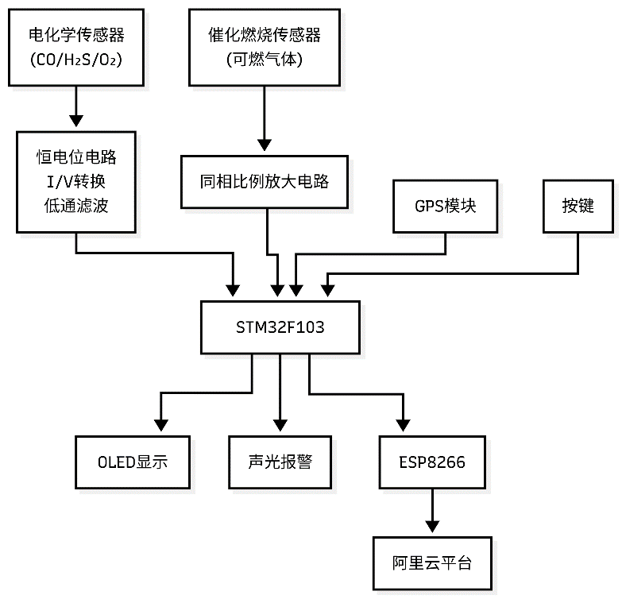
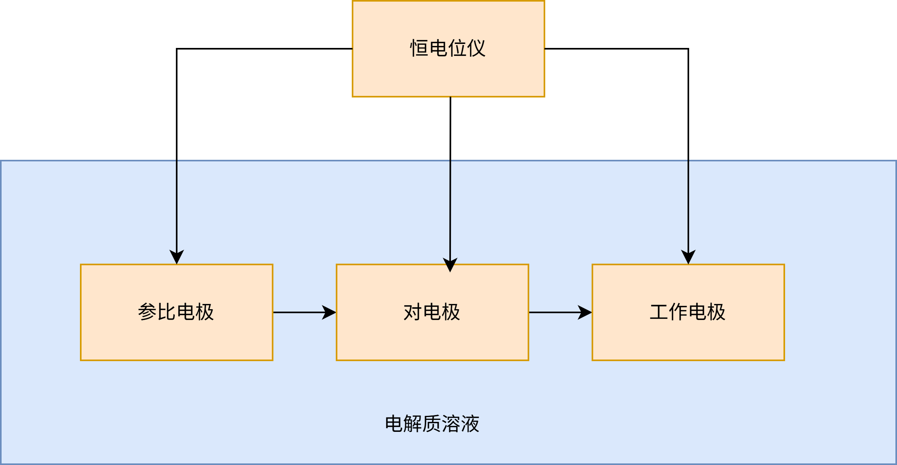
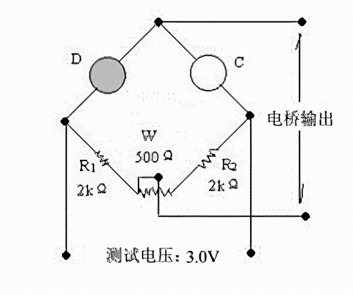
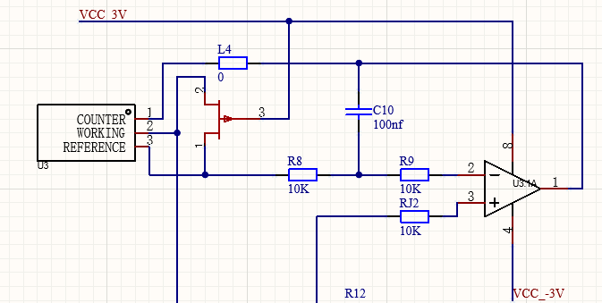
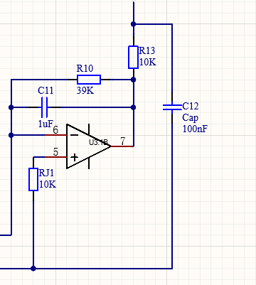
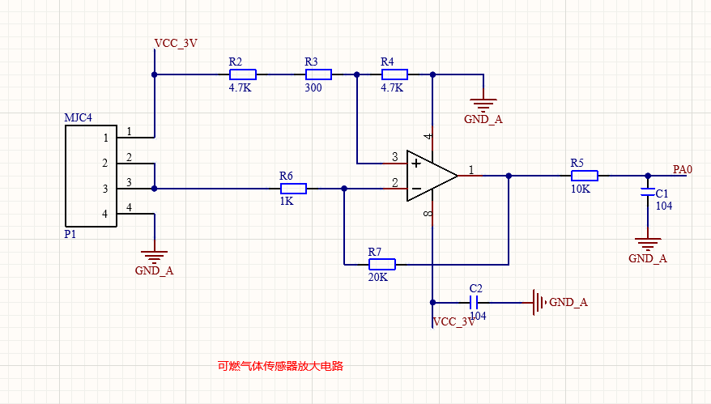
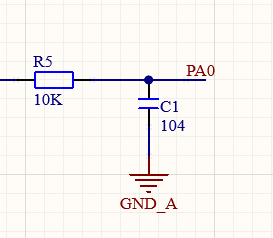

# 电化学式传感阵列多通道有害气体微弱信号级联调理检测终端

基于 **STM32F103C8T6** 的多通道有害气体检测终端工程项目。自主设计微弱信号调理电路，
实现 CO、H₂S、O₂、可燃气体四路气体同步采集、本地显示与越限报警，并通过
**GPS 定位** 与 **MQTT** 完成远程数据上传。

> 本仓库仅包含技术说明，源代码与硬件工程文件未公开。

---

## 系统架构



```
               ┌──────────────────────────────────────────────┐
  CO/H₂S/O₂    │  恒电位电路 → IV 跨阻放大电路                  │
  三/二电极 ───►│  （nA → 0–3V）                                │──┐
  电化学传感器  │                                              │  │
               └──────────────────────────────────────────────┘  │
               ┌──────────────────────────────────────────────┐  │  ADC
  可燃气体  ───►│  反相比例放大电路（mV 压差 → 0–3V）           │──┼──►  (4ch)
  催化燃烧      └──────────────────────────────────────────────┘  │
                                                                   ▼
   ┌──────────────┐   ┌──────────────────────┐   ┌────────────────────────┐
   │  GPS 模块     │   │  STM32F103C8T6 主控    │   │  ADC 四通道扫描 + DMA   │
   │ (USART3)     │◄─►│  12-bit ADC / DMA     │◄──│  → ADC_Buffer[4]        │
   └──────────────┘   │  中值+均值滤波/零点校准 │   └────────────────────────┘
   ┌──────────────┐   │  浓度解算 / 越限判断    │   ┌────────────────────────┐
   │ ESP8266 WiFi │◄─►│                       │──►│  OLED 128×64 (SPI) 显示 │
   │ (USART1)     │   │                       │   └────────────────────────┘
   └──────┬───────┘   │                       │   ┌────────────────────────┐
          │           │                       │──►│  按键 / 声光报警        │
          ▼           └───────────────────────┘   └────────────────────────┘
   ┌──────────────┐
   │ 阿里云 MQTT   │  ← JSON: {CO, H₂S, O₂, LEL, lon, lat, status}
   └──────────────┘
```

- **传感阵列**：CO / H₂S 用三电极电化学传感器，O₂ 用二电极电化学传感器，
  可燃气体用惠斯通电桥型催化燃烧传感器。
- **级联调理**：nA 级电流 / mV 级压差 → `0–3 V` 电压 → STM32 内部 ADC。
- **主控**：STM32F103C8T6，ADC 四通道规则组连续扫描，DMA 循环搬运，CPU 零参与采集。
- **扩展**：GPS（NMEA-0183）、ESP8266（MQTT/阿里云）、OLED、独立按键、声光报警。

---

## 硬件电路

### MCU 核心

- **STM32F103C8T6**（ARM Cortex-M3），内置 2 路 12-bit 逐次逼近型 ADC，
  最多 16 个外部模拟通道，参考电压 `VREF = 3.3 V`。
- 四路气体信号编入一个**规则通道组**，按顺序扫描，配合 DMA 搬运。

### 气体传感探头接口

**三电极电化学传感器接口**（CO / H₂S / O₂，参比电极 RE 接恒电位仪）：



**可燃气体传感器接口**（惠斯通电桥型催化燃烧，输出 mV 级压差）：



### 微弱信号调理电路（自主设计）

**(a) 恒电位电路** — 为 CO / H₂S 三电极传感器提供稳定电化学工作环境：



- 高精度低噪声基准源 + **JFET 偏压负反馈网络**；
- 利用运放"虚短、虚断"，将参比电极（RE）电位稳定在 **0 V 附近（±1 mV）**；
- 氧化还原反应导致 RE 电位偏转时，运放输出电流至对电极将其拉回，保证工作电极
  电流与气体浓度成正比。

**(b) IV 跨阻放大电路** — 将 nA 级电流线性转换为电压：



- 选用**极低偏置电流运放 TP5592-SR**，避免运放自身偏置电流污染传感器信号；
- 低温度系数、高一致性电阻 + 低损耗电容，保证增益稳定与线性度；
- 反馈电阻可更换以调节增益，输出直接线性映射到 `0–3 V`，适配 ADC 量程。

**(c) 反相比例放大电路** — 处理可燃气体传感器 mV 级压差：



- 高精度匹配电阻构成分压与反馈网络，放大倍数精确稳定、温漂一致；
- 高共模抑制，抑制电磁干扰与共模噪声，稳定放大 mV 级小信号。

### 辅助抗干扰电路



- 各调理电路输出端设**单点接地去耦**，运放输出到 ADC 输入就近并联旁路电容；
- 滤除高频电磁干扰与电源纹波。

### 供电架构（双路独立隔离）

- **4.7 V 锂电池**为总输入，经**两路独立 LDO** 分别供电：
  - 数字主控部分 `3.3 V`；
  - 模拟调理部分 `3.0 V`。
- 数字与模拟电源隔离，削弱数字开关噪声对微弱模拟信号的干扰。

### 功能扩展模块

| 模块 | 接口 | 说明 |
| --- | --- | --- |
| GPS 定位 | USART3（PB10/PB11 交叉，9600 8N1） | 中科微 GNSS，支持北斗/GPS/GLONASS，输出 NMEA-0183 |
| 物联网通信 | USART1（PA9/PA10 交叉，115200 8N1） | ESP8266，AT 指令驱动 MQTT，含 ESD 防护、电源滤波、禁铜区 |
| 人机显示 | SPI（7 线） | 0.96" OLED，128×64，100 ms 刷新 |
| 功能按键 | GPIO（低电平有效） | 确定 / 上移 / 下移，软件消抖、非阻塞 |
| 声光报警 | GPIO | 越限时本地指示 + 云端报警状态上传 |

### PCB 设计

- 模拟区 / 数字区 / 电源区 / 通信接口区**分区布局**；
- 模拟地与数字地**单点（0 Ω）连接**，抑制地环路干扰；
- 各模块供电分离、跳线帽连接便于分级调试；
- **四层板**：顶层器件层，底层大面积接地（散热 + 屏蔽），中间负片电源层。

---

## 软件技术

软件采用**模块化分层**结构：信号获取 → 算法处理 → 通信协议 → 交互逻辑。

### ADC + DMA 四路同步采集

| 通道 | 引脚 | 传感器 |
| --- | --- | --- |
| 可燃气体 | PA0 | MJC4/3.0L 催化燃烧 |
| 一氧化碳 | PA1 | 电化学 |
| 硫化氢 | PA6 | 电化学 |
| 氧气 | PA7 | 电化学 |

- ADC1 独立模式，连续 + 扫描，规则组 4 通道，采样时间 239.5 周期，数据右对齐；
- **DMA1 通道 1**：外设地址固定、存储器地址自增、16-bit、循环模式、高优先级；
- DMA 传输完成中断中，将 `ADC_Buffer[4]` 送入 `dat_send_voltage` 结构体。

### 零点校准（中值 + 均值滤波）

- 采集 **5 组 × 4 通道** 原始值存入 `ADC_Buffer_Zero[20]`；
- 每通道排序，**去掉最大、最小值，取中间 3 个均值**作为零点基准；
- 抑制脉冲干扰，提升零点稳定性；后续浓度计算减去零点基准得到真实值。

### WiFi / MQTT 通信

- STM32 经 USART1 发送 AT 指令配置 ESP8266 联网、MQTT 参数，连接阿里云；
- 数据打包为 **JSON** 上传（气体浓度 + GPS 坐标 + 状态），间隔约 300 ms；
- `printf` 重定向至 USART1，统一命令与负载发送。

### GPS 报文解析

- "中断逐字节接收 → `$` 起始同步 → `\n` 结束判定"；
- 主循环解析 **GNRMC** 语句，逗号分隔字段提取经纬度，度分制 → 度制并按半球赋符号。

### 人机交互（六级菜单）

| 层级 | 界面功能 | 操作 |
| --- | --- | --- |
| 0 级 | 首页数据 | 显示气体浓度 + 经纬度 |
| 1 级 | 首页翻页 | 分页显示各气体数据 |
| 2 级 | 功能菜单 | 报警设置 / 零点校准入口 |
| 3 级 | 子功能选择 | 具体设置项选择 |
| 4 级 | 参数设置 | 阈值 / 校准模式调整 |
| 5 级 | 保存确认 | 确认保存修改 |

---

## 关键代码

以下仅摘录各关键节点的核心实现（完整源码与工程未公开），代码见 [`code/`](code/) 目录。

### ADC + DMA 四路同步采集

4 通道规则组 + DMA1 循环搬运，CPU 零参与采集。见 [`code/adc_dma_init.c`](code/adc_dma_init.c)。

```c
ADC_RegularChannelConfig(ADC1, ADC_Channel_0, 1, ADC_SampleTime_239Cycles5); // PA0 可燃
ADC_RegularChannelConfig(ADC1, ADC_Channel_1, 2, ADC_SampleTime_239Cycles5); // PA1 CO
ADC_RegularChannelConfig(ADC1, ADC_Channel_6, 3, ADC_SampleTime_239Cycles5); // PA6 H2S
ADC_RegularChannelConfig(ADC1, ADC_Channel_7, 4, ADC_SampleTime_239Cycles5); // PA7 O2
ADC_DMACmd(ADC1, ENABLE);
```

### DMA 中断 + 零点校准（中值 + 均值滤波）

DMA 传输完成即提取 4 通道原始值；校准模式下累计 5 组，排序后去极值取中间 3 个均值。
见 [`code/dma_isr_zero_calib.c`](code/dma_isr_zero_calib.c)。

```c
qsort(dat_CO, 5, sizeof(float), compare);          // 5 个值排序
mid_CO = (dat_CO[1] + dat_CO[2] + dat_CO[3]) / 3.0; // 去掉最大/最小，取中间均值
```

### ESP8266 AT 指令接入 MQTT

复位 → 关回显 → Station → 连热点 → MQTT 用户配置 → 连接 → 订阅，数据按 JSON 上报。
见 [`code/esp8266_mqtt.c`](code/esp8266_mqtt.c)。**连接参数均为占位符，需自行替换。**

```c
printf("AT+CWJAP=\"%s\",\"%s\"\r\n", WIFI_SSID, WIFI_PASSWORD);
printf("AT+MQTTCONN=0,\"%s\",1883,1\r\n", MQTT_HOST);
printf("AT+MQTTPUB=0,\"%s\",\"{\\\"method\\\":\\\"thing.event.property.post\\\",...}\",0,0\r\n", topic_pub);
```

### GPS NMEA-0183 报文解析

中断逐字节接收、`$` 同步、`\n` 判决；按逗号分隔提取 GNRMC 字段，度分制转十进制度。
见 [`code/gps_nmea_parse.c`](code/gps_nmea_parse.c)。

```c
intger  = latitude_u / 100;              // 整数度
minutes = latitude_u - intger * 100;     // 分
latitude_end = intger + minutes / 60.0;  // 度 + 分/60
```

---

## 关键参数与实测数据

### IV 跨阻放大电路测试（线性度）

| 输入电流 (µA) | 输入电压 (µV) | 输出电压 (mV) | 放大倍数 |
| ---: | ---: | ---: | ---: |
| 10 | -111.787 | 389.988 | 3489 |
| 20 | -212.920 | 779.987 | 3663 |
| 40 | -415.264 | 1560.00 | 3757 |
| 50 | -516.477 | 1950.00 | 3775 |

> 各量程放大倍数稳定、线性度良好，无失真与饱和。

### 零点校准

| 测量次数 | 电压 (V) |
| --- | --- |
| 第一次 | 0.001 |
| 第二次 | 0.000 |

> 参比电极稳定在 0 V 附近，恒电位电路输出稳定，满足微弱电流测量要求。

### 主要指标

- 气体通道：4 路（CO / H₂S / O₂ / 可燃气体）
- ADC：12-bit，4 通道扫描，DMA 循环，采样频率 100 Hz ~ 1 kHz 可调
- 显示：0.96" OLED 128×64，100 ms 刷新
- 定位：GPS/北斗/GLONASS，NMEA-0183
- 通信：ESP8266 WiFi + MQTT → 阿里云，约 300 ms 上传
- 供电：4.7 V 锂电池，双路 LDO（3.3 V 数字 / 3.0 V 模拟）隔离
